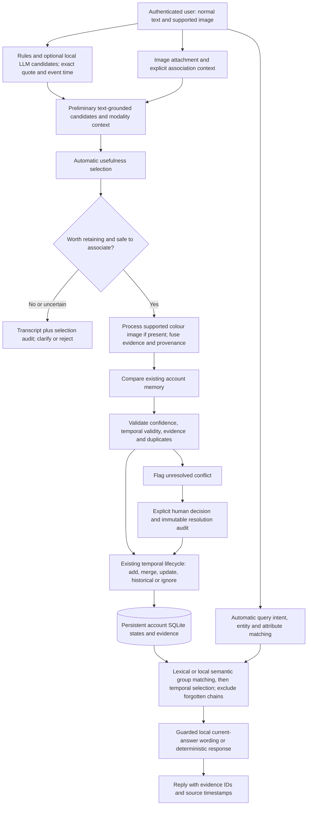
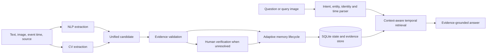

# Integrated NLP + Computer Vision architecture

## Authenticated automatic-memory flow

The account UI now follows the original diagram with an explicit usefulness
selection stage. See [the audit and traceability table](automatic_memory_architecture_audit.md)
and [the implementation/evaluation report](automatic_memory_implementation.md).
The older Store/Ask demo remains available and the frozen evaluation is unchanged.

The [local-first extension](local_models_implementation.md) prefers Ollama for
untrusted candidate extraction/current-answer wording and a separate local
embedding model for semantic nominations. Missing runtimes use the deterministic
paths. [Setup and manual checks](local_models_setup.md) distinguish implemented
adapters from actual model-inference verification.

Local LLM/embedding integration is implemented, but real inference was blocked
by missing Ollama/models at development time. General attributes use lexical
matching or local semantic nominations followed by the existing temporal selector.
Light mode has no pretrained
detector. The separately trained Open Images head remains limited to four car
colours under its opt-in profile. Unsupported image-only association requests ask
for clarification rather than inventing object identity.

## Preserved legacy data flow

The central unit is a temporal state, not a chat message. NLP and CV create evidence for the same candidate and the validation layer decides whether the observation adds, corroborates, updates, conflicts with, or is irrelevant to the accepted state chain.

## Module responsibilities

| Layer | Files | Responsibility |
|---|---|---|
| NLP extraction | `src/nlp/` | Normalize text; extract tracked entity, identity, color relation, event and time; create text embeddings |
| CV extraction | `src/cv/`, `src/multimodal/visual_pipeline.py` | Validate image; detect/localize an object; crop region; estimate color; create image embedding; report active backend |
| Multimodal fusion | `src/multimodal/fusion.py` | Combine claim and image analysis, compute agreement/confidence, and build one candidate |
| Evidence validation | `src/memory/conflict.py`, `update.py` | Gate confidence/association, detect contradictions, reject unsupported state changes |
| Memory lifecycle | `src/memory/` | Atomically store states/evidence, preserve history, rebuild chronological links, migrate SQLite |
| Retrieval | `src/retrieval/` | Resolve identity, select state by intent/event time, retrieve only evidence linked to selected states |
| Answering | `src/agent/` | Parse questions, produce structured answer status and deterministic evidence-grounded text |
| Demonstration | `app/streamlit_app.py` | Show NLP/CV outputs, lifecycle decisions, review conflicts, ask questions, inspect evidence/timeline |

## Unified representation

Each accepted or conflicting state contains:

- `memory_id`, `entity`, `entity_id`, optional `entity_ref`, `attribute`, and normalized `value`;
- observation/event `timestamp` and separate UTC `ingested_at`;
- `status`, confidence, event, predecessor, conflicting value, session and source;
- zero or more text evidence records; and
- zero or more visual evidence records.

Text evidence records include a stable evidence ID, source text, source session, event timestamp, ingestion timestamp, extractor identifier, confidence, and optional embedding. Visual evidence records include image ID/path, label, bounding box, visual value, source session, event and ingestion timestamps, detector/attribute/embedding identifiers, confidence, association status/reason, and whether the observation supports the state.

Legacy databases are migrated in place by adding nullable/defaulted columns. Legacy JSON evidence remains readable because new fields have safe defaults.

## Association and conflict policy

1. One detector match for the named entity is `verified` and may support a state.
2. Detector-free evidence submitted with an explicit context is `contextual`. It may be stored and cross-checked but cannot independently establish or rewrite state.
3. Multiple matching objects are `ambiguous`; a different/no tracked object is `unmatched`. Neither can support state.
4. Confident text–image disagreement creates `CONTRADICTORY` evidence and leaves the accepted chain untouched.
5. Human verification chooses one presented value. The confirmation passes through the same memory engine and the conflict becomes `RESOLVED`.

## Temporal semantics

Observation time controls validity. Ingestion time records when the system received the observation and never silently replaces event time. Accepted states are ordered by event timestamp; the latest is current and earlier values are historical. Compatible late evidence can extend a state's start only when it does not jump across an intervening different state.

## Retrieval contract

The retriever resolves an explicit identity before selecting current, previous, original, after, when, history, evidence, as-of, or conflict semantics. It returns answer-supporting state IDs and evidence IDs. Conflict answers are `uncertain` until resolved; unsupported or ambiguous requests abstain. An optional LLM can only rephrase a grounded prompt and is rejected if it introduces another known color.

## Runtime profiles

The authenticated account interface also supports an explicitly enabled Groq text
provider for unverified candidate extraction, advisory selection and grounded
conversational phrasing. Memory acceptance and all lifecycle writes remain local.
Local semantic embeddings are independent and optional; lexical retrieval stays
available. See [current provider architecture and tests](groq_implementation.md)
and [privacy/setup](groq_setup.md). This does not change frozen Track A results or
add general visual recognition. The legacy demonstration remains deterministic.

- **Light/Track A:** rules, hashing-256, no detector, HSV color, histogram image embeddings. Fully offline and the only profile with frozen comparative results.
- **Optional pretrained:** sentence transformer, YOLO, CLIP, and optional trained heads. Adapters exist, but release-level real-image performance has not been established.

## 26 October 2026: protected research profile

The new account profiles add a local SSDLite detector with unassociated multi-object
observations, optional cached description loading, versioned candidate/source-span
metadata and account-level external-processing consent. Content/evidence encryption
is opt-in in a separate workspace; existing plaintext stores are not converted.
Privacy controls span input sensitivity, minimised API transmission, authorization,
encrypted persistence, derivative invalidation, export, erasure and inactivity
retention. See the complete [privacy architecture diagram and threat model](privacy_threat_model.md)
and [operational setup and manual checklist](research_upgrade_setup.md).

Only compact detector inference has been executed in this phase. Caption-model
inference, real semantic embedding comparison, independent general-object accuracy
and browser validation remain unverified. Earlier benchmark descriptions above
retain their original controlled scope and historical results.
