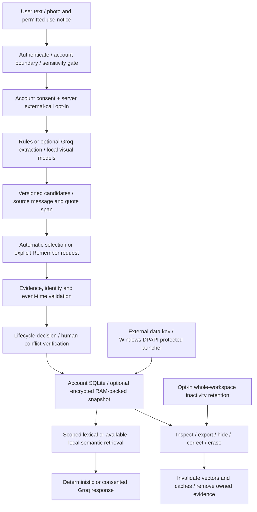

# Privacy threat model and data lifecycle

Scope: localhost research application, authenticated account workspace. This is
not a claim of production security, regulatory compliance, E2EE or bias-free AI.
Use `app/account_app.py` for these controls. The historical anonymous
`app/streamlit_app.py` demonstration and direct low-level `MemoryAgent` calls do
not acquire account consent/retention/sensitivity controls; do not expose that
legacy route as a protected public service.

## Assets and adversaries

Assets include conversation messages, selected facts and history, uploaded pixels,
source references, conflicts/rationales, summaries, embeddings, credentials and
account/login metadata. Consider another authenticated user, a malicious upload or
prompt, an untrusted model prediction, a disk-copy attacker without the data key,
and a compromised server process. The last attacker is outside encryption-at-rest
protection: it can access decrypted content and server-held keys.

| Risk | Implemented control | Residual risk / operational requirement |
|---|---|---|
| Another account requests a conversation, image or audit | Authenticated UID selects the workspace; methods authorize conversation IDs; image reads require the account evidence directory | Not a general Internet-facing identity service; server/OS permissions still matter |
| Stolen account DB/evidence files | Protected profile uses cryptography Fernet authenticated encryption, HKDF account-separated keys, RAM-only SQLite and encrypted PNG evidence | Legacy profile remains plaintext; account registry usernames/login metadata remain outside the encrypted content store; RAM, swap, crash dumps and compromised process are not protected |
| Missing/wrong key, tampered ciphertext | Fail closed, authenticate before deserialization; no plaintext fallback or overwrite; OS lock rejects a second open encrypted workspace | Key loss prevents recovery; keep separately protected backups; current encrypted profile supports one open workspace per account |
| Failed snapshot publication / lost update | RAM changes are not acknowledged until atomic ciphertext publication; failed publication restores prior SQLite snapshot; exclusive OS lock | Large workspaces need RAM and complete snapshot writes; not a distributed/cloud storage design or power-loss certification |
| Secret or sensitive text retention/transmission | Conservative gate before chat/legacy ingest/ask storage; Groq transport checks payloads too | Regex classification is not comprehensive PII/DLP detection; do not submit secrets or sensitive personal records |
| Unwanted external processing | Separate server opt-in/key AND default-off account preference; revoke preference immediately; fixed HTTPS endpoint, certificate validation, bounded payloads and no alternate provider | Previously transmitted content cannot be recalled; provider policy/settings govern processing/retention |
| Model invents facts or object identity | Exact-quote candidate validation, unverified model metadata, independent selection/temporal engine; general detections stay unassociated; unsupported attributes are unknown | Quote containment does not prove semantic entailment; captions can hallucinate and are never acceptance evidence |
| Sensitive inference from photos | Person detections have no colour attributes in general-object observations; description prompt prohibits personal attributes and filters suspicious output | Prompt/keyword filtering is incomplete; VLM inference is not yet validated; do not use for consequential decisions |
| Forgotten data reappears | Hide complete fact chain; purge embedding generations; clear extraction/response caches; remove transcript context from response prompts when hidden facts exist | Original transcripts/evidence remain inspectable by the owner until explicit erasure; already delivered responses cannot be recalled |
| Deleted data reappears | Full-workspace erasure removes messages, facts, summaries, conflicts, visual observations, selection/priority events, vectors and owned UUID evidence; empties caches and compacts SQLite | Backups, filesystem remnants, another client's already rendered page, exports and provider copies are outside the operation |
| Evidence cleanup fails | DB references disappear first; report pending evidence cleanup count; erasure can be retried | Filesystem/database operations are not one crash-atomic transaction; orphan files may require retry |
| Photo metadata leaks | Persist re-encoded RGB PNG without original image metadata; protected profile encrypts bytes | Pixel content itself can reveal private information; permitted-use notice is not automatic legal permission checking |
| Unsafe downloaded weights | Explicit official-host bounded download with filename hash check; weights-only torch loading; no automatic downloads at startup | Only load trusted assets; weight/data licences and supply-chain maintenance remain operator responsibilities |

## Data classes and retention

- **Authentication:** salted scrypt password hashes and hashed expiring session
  tokens. Registry usernames and login timing remain plaintext metadata; protect
  the OS account/disk separately. No registry credentials enter exports or Groq.
- **History:** user and assistant messages. Blocked sensitive turns are not saved.
- **Promoted memory:** accepted claims and temporal states with evidence. A model
  output alone is not independent verification. Disabling automatic memory keeps
  ordinary messages in history; an explicit Remember request remains possible.
- **Evidence / derivatives:** uploaded image pixels, visual observations,
  summaries and embedding generations. Exports intentionally contain personal
  text and should be protected by the recipient. Exports omit image paths/vectors
  and do not include a binary photo bundle.
- **Minimal privacy audit:** erasure action/time/actor/count; no copied source
  text. Account/login metadata is not deleted by workspace erasure.
- **Backups and remote copies:** not managed here. No guarantee of remote deletion,
  forensic erasure, zero provider retention or deletion from user-made exports.

Default retention is no automatic expiry. An account can opt into **whole-workspace
inactivity expiry** (1–3650 days). On a later app interaction, last message ingestion
time—not its observation/event date—is checked. Expiry erases the complete content
workspace, avoiding retained summaries or assistant copies of selectively deleted
facts. This is not a background timer or per-record retention scheduler.

Legacy stored content is not retroactively classified, encrypted or scrubbed by
these migrations. Inspect/export/erasure requires the account owner's action;
this implementation phase did not open any existing user database.

## Ethical and research boundaries

Obtain permission to process uploaded photos and respect licensing/attribution.
Do not infer race, religion, health, sexuality, age, emotions or personal identity.
Object labels/colours do not establish ownership, sameness or physical identity.
Detector errors, weak colour labels and lighting/occlusion bias remain research
limitations. No fairness claim is made. Human correction is accountable evidence
of a user's decision, not objective proof that a photograph shows the same object.

Before public hosting, assess HTTPS ingress, session/cookie policy, rate limits,
storage/backup durability, OS permissions, key custody/recovery and deletion of
backups. This phase does not deploy the application or configure those services.
