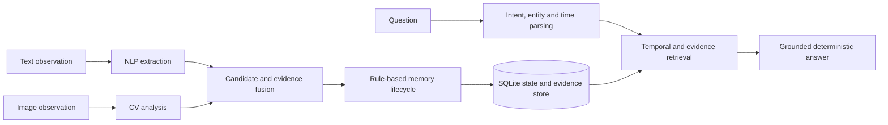

# Research synthesis

## 1. Research problem and motivation

Long-running agents receive observations at different times and through different modalities. A value that was once correct can later become historical, supporting evidence can arrive out of order, and an image can be unrelated to the entity named in accompanying text. Keeping only the latest value loses history, while keeping an unordered transcript does not say which state was valid at a requested time.

This project investigates an **adaptive evidence-grounded memory framework** for a constrained multimodal domain. It extracts structured colour observations from text and images, associates evidence with an entity state, preserves superseded states, and answers current and historical questions from the selected states and their provenance. The system is not a general chatbot: its implemented domain is a small entity lexicon and the `color` attribute, and its default answers are deterministic templates over retrieved memory.

## 2. Research objectives and questions

The implementation and frozen Phase 6 experiment address five questions:

1. Whether adaptive state memory improves temporal question answering over no-memory, latest-value, naive retrieval, and append-only alternatives.
2. Whether state-specific provenance improves supporting-evidence precision and recall.
3. Whether event-time ordering and conflict handling preserve a consistent lifecycle under changes, late evidence, and controlled cross-modal disagreement.
4. Whether explicit identity references and verified visual associations prevent unrelated evidence from changing another state.
5. Where the system abstains or fails, including unseen temporal wording, ambiguous identity, missing history, and unavailable visual models.

The study does not test open-domain conversation quality, detector accuracy on natural photographs, learned memory policies, or general object re-identification.

## 3. Limitations of simpler memory systems

A conventional chatbot can answer from its current prompt but has no inspectable persistent state contract. An append-only log preserves observations but requires downstream logic to determine which one was effective. A latest-value store answers current questions but destroys the red state after a red-to-blue update. Similarity-only retrieval can return a semantically close but temporally wrong record. Naive multimodal storage can also associate a nearby image with a text claim without verifying that the detected object matches the claim entity.

The implemented framework addresses these problems together: it represents each `(entity_id, attribute)` value as a timestamped state, links states in event-time order, records source evidence on the state that ingestion produced, and selects states according to query intent. Standard techniques such as SQLite, regular expressions, HSV colour extraction, embeddings, and object detection are supporting components. The implemented contribution is their integration into an inspectable temporal lifecycle with state-specific multimodal provenance.

## 4. Architecture and end-to-end data flow

`MemoryAgent.remember` extracts text claims, analyzes an optional image, builds evidence records, and invokes the independent `MemoryEngine`. The engine chooses `ADD`, `UPDATE`, `MERGE`, `HISTORICAL`, `CONTRADICTORY`, or `IGNORE` inside a store transaction. `MemoryAgent.ask` parses a query, retrieves the applicable temporal states, scopes image evidence to those states, and produces an answer with status, supporting state IDs, supporting evidence IDs, timestamps, and a grounded prompt.

The Streamlit application creates one `MemoryAgent` and private file-backed namespace per browser session. Tests and benchmarks use temporary files or `:memory:` SQLite and do not open the configured user database.

## 5. NLP extraction and temporal interpretation

The NLP path normalizes text, finds tracked entities, recognizes ordinal references such as `first car`, extracts colour relations and event cues, and resolves explicit or deictic time expressions. An explicit event time takes precedence over ingestion order. If the text has no resolved event time, the caller-supplied observation time is used; a missing source time is recorded as an ingestion-time fallback.

Questions are mapped to current, previous, original, after, change, when, evidence, history, or as-of intents. Temporal retrieval then selects the appropriate state rather than retrieving the newest record for every question. This rule-based coverage is intentionally finite. Phase 6 exposed `immediately preceded` as an unseen previous-state wording and `Initially my ... is ...` as a conservative extraction failure.

## 6. CV observations and evidence association

The visual pipeline can use configured detector/CLIP components when locally available, with HSV and colour-histogram fallbacks in light mode. A visual record stores image ID/path, detected label, bounding box, visual value, confidence, embedding, source session/time, association status, reason, and `supports_state`.

Only a single detector match to the claim entity is `verified` and allowed to establish, support, or contradict a state. Detector-free analysis is `contextual`: it remains provenance but has `supports_state: false`. Ambiguous and unmatched results cannot change memory. Retrieval first selects temporal states and then returns image evidence attached to those records, preventing a session-level image search from silently grounding the wrong state.

Phase 6 controlled detector annotations exercised this association logic. They are mocks/deterministic annotations, not pretrained detector measurements. Real-photo Track B was not performed.

## 7. Adaptive memory lifecycle

The memory engine applies the following rules:

| Action | Implemented result |
|---|---|
| `ADD` | Create the first current state for an entity and attribute. |
| `UPDATE` | Insert a later differing state, mark the older state historical, and rebuild links. |
| `MERGE` | Add novel corroborating evidence to a compatible state without duplicating an exact retry. Earlier compatible event time may extend that state's start. |
| `HISTORICAL` | Insert a differing late observation into its event-time position without replacing the newest state. |
| `CONTRADICTORY` | Preserve verified disagreement as a separate non-chain record; do not apply it as established state. |
| `IGNORE` | Create no state for unsupported, irrelevant, ambiguous, or insufficient input. |

SQLite transactions and nested savepoints cover ID allocation, evidence writes, status changes, and chain rebuilding. Tests inject failures and use concurrent connections to verify rollback and prevent partially visible transitions. These guarantees cover handled database/application failures; SQLite and image files do not form a crash-atomic distributed transaction.

## 8. Identity, provenance, and conflict handling

States have both a canonical entity category and an `entity_ref`. Explicit ordinal references create separate IDs and histories, and a category-only question abstains when more than one matching identity exists. This solves controlled `first car`/`second car` cases, not general naming, ownership, alias resolution, or visual re-identification.

Text and image evidence retain independent source timestamps and session IDs. Answers cite evidence from selected states and expose stable supporting references. A verified text/image disagreement becomes `CONTRADICTORY`; contextual, ambiguous, or unmatched imagery cannot raise that conflict.

Phase 7 identified a presentation limitation: the Streamlit timeline iterated stored entities but called `timeline_for` without the corresponding `entity_ref`, so two same-category histories could disappear. Phase 8 confirmed and fixed that UI path while leaving the memory engine unchanged. Streamlit integration tests now verify distinct first-car and second-car histories; a real-browser capture remains pending.

## 9. Temporal and evidence-grounded question answering

The temporal retriever builds an ordered chain and handles current, original, previous, history, as-of, before/after, and evidence requests. If no state exists at or before an as-of time, or a category reference is ambiguous, it returns an abstention with a reason. The answer generator uses deterministic templates and retrieved values. An optional LLM may only rephrase; a guard rejects output that omits selected values or introduces another known colour.

This differs from latest-value memory because the answer depends on temporal intent: for `red -> blue -> black`, current is black, previous is blue, original is red, and an as-of query between blue and black returns blue. It differs from a conventional chatbot because the response includes an inspectable chain from answer to state, evidence, source session, and event time.

## 10. Experimental design, baselines, and ablations

Phase 6 froze 15 unscored development scenarios and 100 Track A test scenarios before the reported run. The test set contains 210 ingest sessions and 265 questions in 11 controlled families. It uses rule-based NLP, hashing embeddings, rendered images, controlled detections, corrupt bytes, and in-memory SQLite. Scenario-cluster bootstrap intervals keep questions from one scenario together.

Eight systems received identical inputs: no memory, latest value, naive multimodal top-1 retrieval, append-only temporal memory, no provenance, no visual linking, no text/image conflict handling, and the complete system. Pairwise overall-accuracy comparisons use identical question pairs, exact two-sided McNemar tests, and scenario-cluster bootstrap intervals. The p-values are descriptive; multiple systems and metrics were examined and no multiplicity-adjusted significance claim is made.

The frozen input SHA-256 values are:

- Development: `a05c713fad1d8c06159c1b6a53502ea8748ac1e76ebb3ce39225aaa91c2e02bc`
- Test: `831449bb23989915803bf715071a656bf663c6c335320890b8340edfa9fadaf7`

## 11. Measured Track A results

The complete system produced the following frozen results. Counts and denominators come from `reports/phase6/ablation_results.json`.

| Metric | Result |
|---|---:|
| Overall accuracy | 240/265 = 0.906, scenario CI [0.874, 0.940] |
| Current-state accuracy | 90/90 = 1.000 |
| Historical-state accuracy | 40/55 = 0.727, CI [0.656, 0.816] |
| Initial-state accuracy | 15/20 = 0.750, CI [0.550, 0.900] |
| Full-history accuracy | 25/30 = 0.833, CI [0.667, 0.933] |
| Entity-identity accuracy | 30/30 = 1.000 |
| Evidence precision / recall | 0.908 / 0.914 over 245 labelled questions |
| Answer coverage | 245/265 = 0.925 |
| Correct abstentions | 20/20 |
| Unsupported-answer rate | 25/245 = 0.102 answered questions |
| Answer-schema validity | 265/265 = 1.000 |
| Lifecycle accuracy | 200/210 = 0.952, scenario CI [0.913, 0.990] |
| Controlled conflict P/R/F1 | 1.000 / 1.000 / 1.000; 10 TP, 0 FP, 0 FN |
| Controlled visual precision | 1.000; 30 TP, 0 FP |
| Controlled visual false-association rate | 0/15 = 0.000; 15 TN |

Overall accuracy was 20/265 for no memory, 125/265 for latest value, 141/265 for naive multimodal retrieval, and 195/265 for append-only temporal memory. The complete system tied no provenance at 240/265 while the latter had zero citation precision and recall. It scored 220/265 without visual linking and 220/265 without conflict handling. The complete system did not exceed append-only memory on the historical or initial subgroups.

These comparisons support differences on this constructed Track A benchmark. They do not establish natural-language, real-photo, or external-population superiority.

## 12. Error analysis and limitations

The 25 complete-system answer errors consist of 15 previous-state questions whose `immediately preceded` wording was parsed as current, plus five initial and five full-history errors caused by five ignored `Initially my ... is ...` observations. The same extraction defect accounts for the 10 lifecycle errors. Five correctly answered previous-state questions cited both adjacent states while the gold annotation names only the minimally sufficient previous source. Ten `observations justify` questions used an unrecognized evidence cue but still returned the correct value and citation.

The benchmark is a templated controlled challenge set with no human agreement study, natural prevalence, calibrated confidence, licensed real-photo track, or external replication. Only colour is implemented. Identity support is limited to explicit ordinal references. Equal-time observations retain insertion-order behavior. Manual browser validation and restart capture remain pending. A standalone migration of a copied genuine pre-Phase-5 database has not been performed. Track B is blocked by absent local configured model assets and the missing `transformers` package; no model was initialized or downloaded.

## 13. Conclusions and future work

The evidence supports a conservative conclusion: the project implements and tests a coherent adaptive temporal state store with state-specific text/image provenance, controlled conflict handling, explicit ordinal identity isolation, and grounded current/historical answers. The frozen Track A evaluation shows where this integrated mechanism helps simpler baselines and where rule coverage still fails.

Future work should use development data to address the documented temporal-language failures, add a new untouched evaluation set for any corrected behavior, design broader identity resolution, calibrate confidence, collect licensed and independently annotated real images, run locally approved pretrained CV models, and seek external replication. Historical Phase 6 artifacts and hashes should remain unchanged.

## Claim-to-evidence audit

| Claim/status | Primary implementation evidence | Test or measured evidence |
|---|---|---|
| **Implemented and tested:** event-time state chains preserve history | `src/memory/update.py`, `src/memory/state_tracker.py`, `src/memory/store.py` | `tests/test_memory.py`, `tests/test_end_to_end.py`, `tests/test_reliability.py` |
| **Implemented and tested:** late compatible evidence uses observation time | `MemoryEngine.process`, `MemoryStore.set_state_start` | `test_late_blue_observation_extends_state_using_event_time`, `test_later_support_does_not_backdate_blue` |
| **Implemented and tested:** transitions are transactional and isolated | `MemoryStore.transaction`, `MemoryAgent._remember` | rollback, incomplete-transition, concurrent-writer tests in `tests/test_reliability.py` |
| **Implemented and tested:** explicit ordinal identities are isolated | `src/nlp/ner.py`, `resolve_entity_id`, `TemporalRetriever.retrieve` | `test_two_explicit_car_identities_remain_separate`; Track A 30/30 identity questions |
| **Implemented and tested:** state-specific provenance is returned | `VisualEvidence`, `ImageRetriever.for_records`, `evidence_items` | `tests/test_multimodal_evidence.py`, `test_answer_contract_has_status_and_supporting_references` |
| **Mocked/controlled only:** detector-verified visual association and conflict | `src/multimodal/visual_pipeline.py`, `src/memory/conflict.py` | mocked detector tests; Track A 30 TP/15 TN and 10 controlled conflicts |
| **Measured Track A:** complete-system and baseline metrics | `src/evaluation/metrics.py`, `benchmarks.py`, `research_reporting.py` | frozen JSON under `reports/phase6/` and hashes above |
| **Automated UI evidence:** browser-session isolation across Streamlit reruns | `app/streamlit_app.py` session state and private path construction | `test_streamlit_browser_sessions_are_isolated_and_persistent` using Streamlit `AppTest` |
| **Pending manual:** browser walkthrough, screenshots, restart observation | documented procedure only | `docs/final_demo_script.md`; no manual capture claimed |
| **Not performed:** genuine legacy database-copy migration | migration exists in `MemoryStore.__init__` | no standalone run against a genuine pre-Phase-5 copy |
| **Not performed/blocked:** real pretrained CV and real-photo generalization | optional backends in `src/cv/` | `reports/phase6/model_availability.json`; Track B unperformed |
| **Future:** broad identity, learned lifecycle, real-photo evaluation | not implemented | no result claimed |
